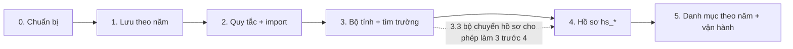

# Kế hoạch triển khai: đề án tuyển sinh theo năm và xét tuyển tính toán được

Tài liệu đi kèm `THIET_KE.md`, `IMPLEMENT.md` và `SO_DO_LUONG_XU_LY.md` (sơ đồ luồng, danh sách bảng thêm / sửa).
Nhánh làm việc: `tich_hop_de_an_tuyen_sinh`.

## Quyết định đã chốt

| # | Quyết định | Ghi chú |
|---|---|---|
| 1 | Dùng mô hình dữ liệu `xt_*` / `hs_*` và chuẩn JSON của tài liệu | Theo `THIET_KE.md`, `chuan_du_lieu/` |
| 2 | **Tổ hợp riêng của trường được gắn tiền tố mã trường khi lưu** (ví dụ `K01` của BKA lưu thành `BKA-K01`) | `dm_to_hop_mon_hoc.ma_to_hop` đang duy nhất toàn hệ thống; file JSON vẫn viết `K01` |
| 3 | Thiết kế cho **nhiều trường**, FTU và BKA chỉ là mốc nghiệm thu đầu tiên | Không có code rẽ nhánh theo mã trường |
| 4 | **Tính điểm bằng Python**, không dùng thủ tục MySQL | Bản JavaScript trong `test_xet_tuyen.html` dùng để đối chiếu |
| 5 | **File JSON chuẩn là nguồn sự thật** cho phần quy tắc xét tuyển | Sửa quy tắc = sửa file rồi import lại |
| 6 | Chấm điểm phù hợp theo 4 tiêu chí: khả năng trúng tuyển 50, ngành 25, học phí 15, vị trí 10 | Lưu trong `xt_tieu_chi_phu_hop`, đổi được sau |

## Quyết định còn chờ

| # | Việc | Bước liên quan |
|---|---|---|
| 4 | Quy tắc chuyển hồ sơ cũ: ngoại ngữ NN1/NN2 thành môn nào; học lực suy ra từ điểm trung bình hay để trống | 4.1 |
| 5 | Giá trị điểm cộng đối tượng ưu tiên theo Thông tư 06/2026 | 5.2 |

## Nguyên tắc chung

- **Migration** viết tay theo quy ước dự án, bắt đầu từ `20261116_0056` (head hiện tại `20261115_0055`).
  **Người dùng tự chạy `make migrate`** vì CSDL là DB dùng chung; chạy thử trên bản sao DB trước.
- Mỗi bước kết thúc có test (unittest backend, `node --test` frontend), lint, sinh lại `backend/API.md`, và một commit.
- API theo quy ước dự án: không trả 404 về dữ liệu; rỗng trả 200 đúng cấu trúc, không tìm thấy id trả 400 kèm `detail`.
- **Không thay đổi kết quả cho người dùng thật** cho đến khi một trường được chuyển sang trạng thái "đang áp dụng".
- **Không viết logic theo mã trường.** Gặp kiểu quy định mới thì thêm kiểu tính hoặc chỉ số dùng chung cho mọi trường.

---

## Giai đoạn 0. Chuẩn bị

| Bước | Việc | Ai làm | Kết quả |
|---|---|---|---|
| 0.1 | ~~Chốt quyết định tính bằng Python, JSON là nguồn sự thật, trọng số chấm điểm~~ **Đã chốt** | Chủ dự án | Bảng "Quyết định đã chốt" mục 4–6 |
| 0.2 | Script **chỉ đọc** `python -m app.scripts.kiem_tra_truoc_tich_hop_de_an [bao_cao.md]` kiểm tra dữ liệu hiện có: đề án trùng trường + năm, chương trình thiếu mã ngành / cơ sở, trường thiếu tỉnh, tổ hợp thiếu chi tiết, mã tổ hợp có thể đụng với tổ hợp riêng | Dev viết, chủ dự án chạy | Báo cáo những gì cần dọn trước giai đoạn 1 |
| 0.3 | Sao lưu DB hoặc tạo bản sao để chạy thử migration | Chủ dự án / DBA | Có môi trường thử |

## Giai đoạn 1. Củng cố việc lưu theo năm

| Bước | Việc | Kiểm tra / nghiệm thu |
|---|---|---|
| 1.1 | ~~Gộp đề án trùng theo báo cáo 0.2~~ **Không cần**: báo cáo 0.2 (16/11/2026) không có đề án trùng; migration `0056` tự dừng nếu phát hiện trùng | Không còn cặp trường + năm trùng |
| 1.2 | **Xong** (`20261116_0056_dats_luu_theo_nam.py`, đã chạy 16/11/2026). **Migration `0056`:** • `dats_tuyen_sinh`: mã trường + năm thành duy nhất; thêm `de_an_nam_truoc_id`; thêm **trạng thái xét tuyển 3 mức**: chưa chuẩn hóa / thử nghiệm / đang áp dụng • `dats_tru_so`: thêm `tinh_thanh_id` • `dats_chuong_trinh_dao_tao`: thêm **mã xét tuyển năm trước** Cập nhật model | Chạy được trên bản sao DB, có `downgrade` |
| 1.3 | **Xong.** Chặn tạo đề án trùng năm ở API (thêm, thêm nhiều, sửa) và bộ import cũ (400 kèm thông báo) | Unit test `test_dats_tuyen_sinh_trung_nam.py` |
| 1.4 | **Xong (chờ thử trên trang quản trị).** Trang Trụ sở chọn tỉnh (tự đoán từ địa chỉ); trang mới **Gắn ngành & cơ sở** (`/admin/de-an-tuyen-sinh/gan-nganh-co-so`): chọn ngành có gợi ý (`app/services/goi_y_nganh.py`), gán cơ sở hàng loạt, mã xét tuyển năm trước; API `GET/PATCH /chuong-trinh-dao-tao/gan-nganh-co-so` | Thử trên trang quản trị; test `test_gan_nganh_co_so.py` |
| 1.5 | **Xong.** **Sao chép đề án năm trước**: `POST /de-an-tuyen-sinh/{id}/sao-chep` (`app/services/sao_chep_de_an.py`) + nút trên trang Danh sách. Sao chép toàn bộ dữ liệu con, tự điền mã xét tuyển năm trước, đề án mới trỏ `de_an_nam_truoc_id` về bản gốc | Test `test_sao_chep_de_an.py`: số dòng các bảng con khớp đề án gốc |
| 1.6 | **Xong.** **Điểm chuẩn**: bảng `xt_diem_chuan` (migration `20261117_0057_xt_diem_chuan.py`), API `/diem-chuan` (chỉ admin; thêm, sửa, xóa, nhập nhiều dòng bằng JSON), trang `/admin/de-an-tuyen-sinh/diem-chuan` | Test `test_xt_diem_chuan.py`: rỗng trả 200, id không tồn tại trả 400, chặn trùng |

**Xong giai đoạn 1:** mỗi trường mỗi năm một đề án, sao chép được sang năm sau, nhập được điểm chuẩn. Dùng được ngay,
không phụ thuộc phần tính điểm.

## Giai đoạn 2. Quy tắc tính được và bộ import

| Bước | Việc | Kiểm tra / nghiệm thu |
|---|---|---|
| 2.1 | **Xong** (`20261117_0058_xt_quy_tac_xet_tuyen.py`; dữ liệu nền viết bằng Python, chạy lại được; bỏ chi tiết của tổ hợp không đủ 3 vị trí như M00, K00). **Migration `0058`:** `dm_chi_so_xet_tuyen`, `xt_bang_quy_doi` (+ chi tiết), `xt_cong_thuc` (+ hệ số môn, thành phần), `xt_phuong_an`, `xt_nhom_dieu_kien`, `xt_dieu_kien`, `xt_diem_cong`, `dats_hoc_phi`, `xt_bo_tieu_chi`, `xt_tieu_chi_phu_hop`, `xt_muc_phu_hop`, `xt_lich_su_import`; dữ liệu nền từ file 03 (chỉ số, chi tiết tổ hợp, bộ tiêu chí mặc định). Không tạo thủ tục MySQL | Chạy trên bản sao DB |
| 2.2 | **Xong** (`app/services/xt_quy_tac.py`: `delete_quy_tac_xet_tuyen` dùng lại ở bước 2.4; chặn cả chuyển chương trình có quy tắc sang đề án khác). Sửa luồng xóa: `delete_de_an_children` dọn cả `xt_*` và `dats_hoc_phi`; API xóa chương trình báo rõ lý do khi đang có phương án | Test: xóa đề án có quy tắc thành công |
| 2.3 | **Xong** (`app/services/xet_tuyen_import.py`, cấu trúc file kiểm bằng Pydantic `app/schemas/xet_tuyen_chuan.py` thay cho thư viện jsonschema; danh mục đọc từ CSDL bằng `DanhMucXetTuyen.tu_csdl`; test với bản sao file mẫu trong `tests/du_lieu/xet_tuyen/`). **Bộ import, phần chuẩn bị** (`app/services/xet_tuyen_import.py`), không cần DB: • kiểm tra như `kiem_tra_de_an.py`, danh mục đọc từ DB • **gắn tiền tố mã trường cho tổ hợp riêng** • cho phép **chuẩn hóa từng phần**: phương án kiểu `THU_CONG` cho quy định chưa tính được, lưu danh sách quy định chưa mô hình hóa • chuyển JSON thành các dòng chờ ghi | Nạp 2 file mẫu ra đúng số dòng: • FTU: 26 công thức, 770 phương án, 51 nhóm điều kiện, 10 điểm cộng • BKA: 7 công thức, 501 phương án, 32 nhóm điều kiện |
| 2.4 | **Xong** (`app/services/xet_tuyen_ghi.py`: `nhap_quy_tac`; khớp đề án theo trường + năm, chương trình theo mã xét tuyển + tên, không ghi đè ngành / mô tả đã nhập tay; đề án chuyển sang "thử nghiệm"). **Bộ import, phần ghi**: một transaction, thay toàn bộ quy tắc của đề án, ghi `xt_lich_su_import` | File lỗi thì không ghi dòng nào |
| 2.5 | API `POST .../{id}/quy-tac/import`; dialog tải file trên trang đề án (hiện số dòng hoặc danh sách lỗi); tab "Quy tắc xét tuyển" xem quy tắc (chỉ đọc) | Import 2 file mẫu lên bản sao DB thành công |

## Giai đoạn 3. Bộ tính điểm Python và nối vào tìm trường

| Bước | Việc | Kiểm tra / nghiệm thu |
|---|---|---|
| 3.1 | **Bộ tính** (`app/services/xet_tuyen/`), hàm thuần không cần DB: quy đổi chứng chỉ / bài thi, tính điểm theo công thức, kiểm tra điều kiện, điểm cộng và điểm ưu tiên (Điều 6, 7), so điểm chuẩn, chấm điểm phù hợp. **Không có điều kiện theo mã trường** (quy định khi review code) | Unit test với các số trong `IMPLEMENT.md` mục 7 (FTU thi THPT A00 26,50; FTU HSA 27,87; BKA TSA 74,17; hồ sơ B không đạt ngưỡng 24…) |
| 3.2 | Đối chiếu với bản JavaScript trong `test_xet_tuyen.html`: xuất kết quả thành file mẫu, so cả 986 phương án | Khớp 100%, kể cả làm tròn |
| 3.3 | **Bộ chuyển hồ sơ**: dựng hồ sơ xét tuyển từ JSON `trinh_do_hoc_van` và form khách, để không phải chờ giai đoạn 4 | Test với hồ sơ mẫu |
| 3.4 | **Migration `0059`:** `xt_lan_danh_gia`, `xt_ket_qua_chuong_trinh`, `xt_ket_qua_phuong_an` (chỉ lưu phương án của chương trình trong top kết quả) | |
| 3.5 | **Nối vào luồng tìm trường:** • đề án "đang áp dụng" dùng bộ tính mới (`phien_ban_thuat_toan = 'xt-v1'`), còn lại dùng thuật toán cũ • giữ nguyên cách trừ / hoàn lượt • lọc trước theo ngành và năm, chỉ tính chương trình liên quan; cache quy tắc theo năm • **đo hiệu năng với dữ liệu giả lập khoảng 300 trường** | Test: trường chưa áp dụng cho kết quả y như trước; thời gian một lượt tìm trong ngưỡng chấp nhận |
| 3.6 | API kết quả: danh sách chương trình, danh sách trường, chi tiết phương án; kiểm tra quyền xem lần đánh giá | Test truy cập lần đánh giá của người khác bị từ chối |
| 3.7 | Giao diện kết quả: bảng xếp hạng, chi tiết phương án, nhãn "Chưa có điểm chuẩn tham chiếu", "Đủ điều kiện xét tuyển thẳng", "Đủ điều kiện nộp hồ sơ, hệ thống chưa tính điểm cho phương thức này" | Thử với hồ sơ mẫu |
| 3.8 | **Bộ test hồi quy nhiều trường**: mỗi trường một thư mục gồm file đề án, hồ sơ mẫu, kết quả mong đợi; chạy toàn bộ trong unittest. Bắt đầu với FTU, BKA, rồi bổ sung ít nhất một trường cho mỗi kiểu đề án (bảng dưới). Trường nào cũng phải có bộ test trước khi chuyển sang "đang áp dụng" | Toàn bộ bộ test xanh; chủ dự án nghiệm thu kết quả trên bản sao DB với điểm chuẩn thật |

**Bộ trường mẫu cho nghiệm thu** (đại diện các kiểu đề án; trường cụ thể chốt khi nhập liệu):

| Kiểu đề án | Ví dụ cần có |
|---|---|
| Xét điểm thi THPT theo tổ hợp, nhiều thang điểm | FTU, BKA (đã có file mẫu) |
| Dùng bài thi đánh giá năng lực riêng (HSA, V-ACT, TSA) | Một trường thuộc ĐHQG Hà Nội hoặc ĐHQG TP.HCM |
| Xét học bạ có ngưỡng | Một trường đại học tư thục hoặc cao đẳng |
| Ngành có ngưỡng đầu vào của Bộ (sư phạm, sức khỏe) | Một trường sư phạm, một trường y |
| Có sơ tuyển hoặc thi năng khiếu (chuẩn hóa từng phần) | Một trường khối quân đội / công an hoặc nghệ thuật |

## Giai đoạn 4. Hồ sơ học sinh `hs_*`

| Bước | Việc | Kiểm tra / nghiệm thu |
|---|---|---|
| 4.1 | Chốt quy tắc chuyển dữ liệu (quyết định còn chờ số 4) | Chủ dự án quyết định |
| 4.2 | **Migration `0060`:** các bảng `hs_*` (không tạo `hs_chi_so`) | |
| 4.3 | API `GET` / `PUT` hồ sơ xét tuyển; **ghi song song** với JSON cũ khi lưu hồ sơ | Test: lưu một lần, hai nơi khớp nhau |
| 4.4 | Script chuyển dữ liệu cũ, xuất báo cáo dòng không chuyển được | Chạy trên bản sao DB trước |
| 4.5 | Màn hình Hồ sơ năng lực thêm các khối bài thi, chứng chỉ, thành tích, nguyện vọng | |
| 4.6 | Bộ tính đọc hồ sơ từ `hs_*`; JSON cũ chỉ giữ cho chat đến khi chat cũng chuyển | |

## Giai đoạn 5. Danh mục theo năm, dữ liệu và vận hành nhiều trường

| Bước | Việc | Kiểm tra / nghiệm thu |
|---|---|---|
| 5.1 | Năm áp dụng cho `dm_to_hop_mon_hoc`, `dm_doi_tuong_uu_tien`, `dm_khu_vuc_uu_tien`: **các bảng đã có sẵn cột** (`nam_ap_dung_tu` / `nam_ap_dung_den`, `nam_ap_dung`), chỉ cần điền dữ liệu và cho bộ tính chọn dòng theo năm tuyển sinh; migration chỉ khi cần thêm `nam_ap_dung_den` cho hai bảng ưu tiên | Test tính năm 2025 và 2026 với hai mức điểm ưu tiên khác nhau |
| 5.2 | Sửa điểm cộng đối tượng ưu tiên theo Thông tư 06/2026 (quyết định còn chờ số 5) | Chủ dự án duyệt bảng giá trị trước khi chạy |
| 5.3 | Job định kỳ dọn kết quả đánh giá cũ | |
| 5.4 | **Quy trình đưa một trường mới vào:** soạn file JSON → `kiem_tra_de_an.py` → import (trạng thái **thử nghiệm**) → thêm hồ sơ mẫu và kết quả mong đợi vào bộ test → đối chiếu → chuyển sang **đang áp dụng** | Mỗi trường "đang áp dụng" đều có bộ test |
| 5.5 | **Trang "Độ phủ dữ liệu xét tuyển"** (quản trị): số trường theo trạng thái; tỷ lệ chương trình có điểm chuẩn, mã ngành, học phí; danh sách quy định chưa mô hình hóa theo trường | Theo dõi được tiến độ nhập liệu |

---

## Thứ tự phụ thuộc

## Điểm cần chủ dự án tham gia

| Bước | Việc |
|---|---|
| 0.1 | ~~Chốt quyết định 1–3~~ Đã chốt |
| 0.3 và trước mỗi migration | Chạy `make migrate` (thử trên bản sao DB trước) |
| 1.1 | Duyệt danh sách đề án cần gộp |
| 3.8 | Nghiệm thu kết quả với điểm chuẩn thật |
| 4.1 | Chốt quy tắc chuyển hồ sơ |
| 5.2 | Duyệt giá trị điểm ưu tiên |
| 5.4 | Chuyển từng trường sang "đang áp dụng" |
