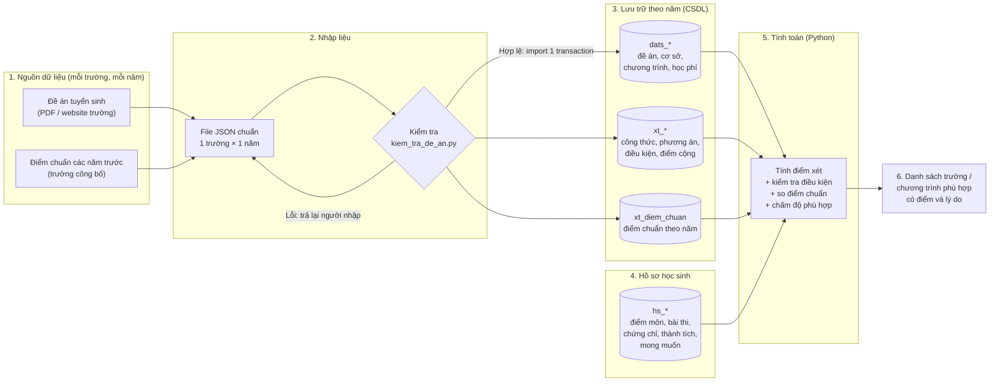
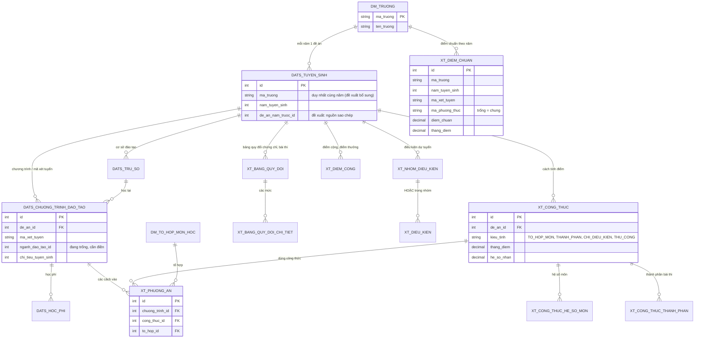
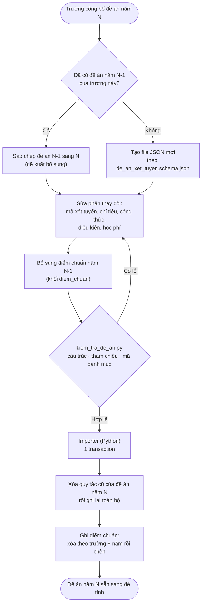
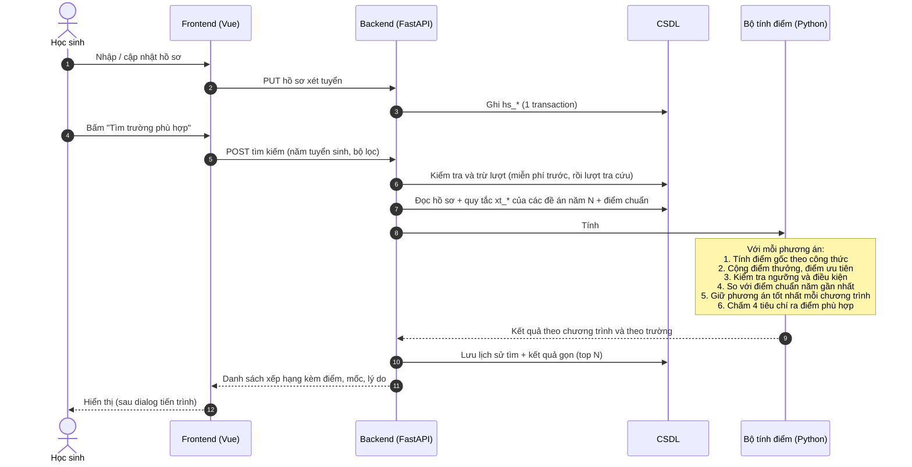
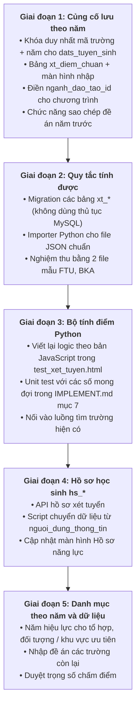

# Sơ đồ luồng xử lý: đề án tuyển sinh theo năm và tìm trường phù hợp

Tài liệu đi kèm `THIET_KE.md` và `IMPLEMENT.md`; kế hoạch từng bước ở `KE_HOACH_TRIEN_KHAI.md`. Đây là **phương án đề xuất**: dùng mô hình dữ liệu và chuẩn JSON
trong hai tài liệu đó, nhưng **viết phần tính điểm bằng Python** thay cho thủ tục MySQL, và bổ sung các phần còn
thiếu cho việc lưu theo năm (khóa duy nhất trường + năm, sao chép đề án năm trước, danh mục có hiệu lực theo năm).

Xem sơ đồ: mở file trên GitHub, hoặc trong VS Code với extension hỗ trợ Mermaid.

---

## 1. Tổng quan: từ đề án của trường đến kết quả cho học sinh

---

## 2. Dữ liệu tuyển sinh được lưu như thế nào

Mọi quy tắc của một năm đều treo dưới **một đề án** (`dats_tuyen_sinh`) xác định bởi **mã trường + năm tuyển sinh**.
Năm mới = đề án mới; dữ liệu năm cũ giữ nguyên để tra cứu và làm mốc so sánh.

**Giải thích ngắn**

| Nhóm | Bảng | Lưu gì | Theo năm thế nào |
|---|---|---|---|
| Đề án | `dats_tuyen_sinh` | Thông tin chung đề án | Khóa **mã trường + năm** (đề xuất đặt duy nhất) |
| Nội dung đề án | `dats_tru_so`, `dats_chuong_trinh_dao_tao`, `dats_hoc_phi` | Cơ sở, chương trình (mã xét tuyển, chỉ tiêu, ngành), học phí | Treo dưới đề án của năm |
| Quy tắc tính được | `xt_cong_thuc` (+ hệ số môn, thành phần), `xt_bang_quy_doi` (+ chi tiết), `xt_phuong_an`, `xt_nhom_dieu_kien` + `xt_dieu_kien`, `xt_diem_cong` | Cách tính điểm, quy đổi chứng chỉ, điều kiện, điểm cộng | Treo dưới đề án của năm |
| Điểm chuẩn | `xt_diem_chuan` | Điểm chuẩn từng mã xét tuyển, từng năm | Lưu riêng theo **mã trường + mã xét tuyển + năm**, dùng năm gần nhất làm mốc |
| Danh mục dùng chung | `dm_to_hop_mon_hoc`, `dm_doi_tuong_uu_tien`, `dm_khu_vuc_uu_tien`... | Tổ hợp, đối tượng / khu vực ưu tiên | Đề xuất thêm **năm hiệu lực** vì quy chế đổi theo năm |
| Hồ sơ học sinh | `hs_ho_so`, `hs_diem_mon`, `hs_diem_bai_thi`, `hs_chung_chi`, `hs_thanh_tich`, `hs_tieu_chi_mong_muon` | Điểm, bài thi, chứng chỉ, thành tích, nguyện vọng | Không theo năm của trường; có năm tốt nghiệp |

---

## 3. Luồng nhập đề án mỗi năm

Ghi chú:

- Mỗi file là **1 trường × 1 năm**, mọi tham chiếu dùng **mã** (mã môn, mã tổ hợp, mã tỉnh...), không dùng id.
- Import lại cùng trường + năm sẽ **thay toàn bộ** quy tắc của đề án đó; dữ liệu năm khác không bị đụng.
- Hai file mẫu `mau_NTH_2026.json`, `mau_BKA_2026.json` dùng làm chuẩn nghiệm thu importer.

---

## 4. Luồng tìm trường phù hợp cho học sinh

**Cách chấm điểm phù hợp (đề xuất trong tài liệu, cần duyệt)**

| Tiêu chí | Trọng số | Cách chấm |
|---|---|---|
| Khả năng trúng tuyển | 50 | Theo chênh lệch điểm xét với điểm chuẩn (quy về thang 30) |
| Ngành | 25 | Đúng ngành / nhóm ngành mong muốn |
| Học phí | 15 | Trong ngân sách; vượt thì giảm dần |
| Vị trí | 10 | Đúng tỉnh / vùng mong muốn |

Chưa có điểm chuẩn thì không chấm, chương trình được gắn nhãn "Chưa có điểm chuẩn tham chiếu".

---

## 5. Lộ trình triển khai

---

## 6. Danh sách bảng phải thêm và phải sửa

Theo hướng mới: dùng mô hình dữ liệu của `THIET_KE.md` / `01_schema.sql`, phần tính điểm viết bằng Python.
Số cột lấy từ `01_schema.sql`.

### 6.1. Bảng phải thêm

**Hồ sơ học sinh (`hs_*`)**

| Bảng | Cột | Lưu gì | Ghi chú |
|---|---|---|---|
| `hs_ho_so` | 16 | Hồ sơ xét tuyển: năm tốt nghiệp, hệ chuyên, tỉnh, khu vực / đối tượng ưu tiên, ngân sách học phí | Khóa ngoại tới `nguoi_dung`, xóa người dùng thì hồ sơ xóa theo |
| `hs_ket_qua_nam_hoc` | 6 | Tổng kết từng năm lớp 10–12: điểm trung bình, học lực, rèn luyện | |
| `hs_diem_mon` | 9 | Điểm từng môn: thi tốt nghiệp THPT và học bạ | |
| `hs_diem_bai_thi` | 9 | Điểm HSA, TSA, V-ACT, SAT, ACT | |
| `hs_chung_chi` | 8 | Chứng chỉ IELTS, TOEFL, JLPT, HSK… | |
| `hs_thanh_tich` | 8 | Giải học sinh giỏi, Olympic… | |
| `hs_tieu_chi_mong_muon` | 4 | Ngành, tỉnh, loại trường mong muốn | |
| `hs_chi_so` | 4 | Bảng phẳng dẫn xuất từ các bảng `hs_*` để kiểm tra điều kiện bằng SQL | **Không bắt buộc** khi tính bằng Python, có thể dựng trong bộ nhớ |

**Quy tắc xét tuyển của đề án (`xt_*`, gắn với đề án từng năm)**

| Bảng | Cột | Lưu gì |
|---|---|---|
| `dm_chi_so_xet_tuyen` | 5 | Danh mục chỉ số dùng trong điều kiện (đã tốt nghiệp, học lực tối thiểu 3 năm, thành tích…) |
| `xt_bang_quy_doi` | 6 | Bảng quy đổi chứng chỉ / bài thi sang điểm |
| `xt_bang_quy_doi_chi_tiet` | 11 | Các mức quy đổi, theo bậc thang hoặc nội suy |
| `xt_cong_thuc` | 21 | Công thức tính điểm: kiểu tính, thang điểm, hệ số nhân, ngưỡng |
| `xt_cong_thuc_he_so_mon` | 5 | Hệ số từng môn của công thức |
| `xt_cong_thuc_thanh_phan` | 12 | Thành phần bài thi / chứng chỉ của công thức |
| `xt_phuong_an` | 8 | Một cách vào chương trình: chương trình × công thức × tổ hợp |
| `xt_nhom_dieu_kien` | 8 | Nhóm điều kiện; các nhóm phải cùng đạt |
| `xt_dieu_kien` | 7 | Điều kiện đơn; trong một nhóm chỉ cần đạt một |
| `xt_diem_cong` | 11 | Quy tắc điểm cộng, điểm thưởng |
| `dats_hoc_phi` | 7 | Học phí theo chương trình và năm học |
| `xt_diem_chuan` | 12 | Điểm chuẩn theo mã trường + mã xét tuyển + năm |

**Cấu hình chấm điểm phù hợp**

| Bảng | Cột | Lưu gì |
|---|---|---|
| `xt_bo_tieu_chi` | 5 | Bộ tiêu chí chấm, có thể có nhiều phiên bản |
| `xt_tieu_chi_phu_hop` | 5 | Trọng số 4 tiêu chí: khả năng trúng tuyển, ngành, học phí, vị trí |
| `xt_muc_phu_hop` | 7 | Các mốc quy ra điểm và nhãn ("Rất phù hợp"…) |

**Kết quả đánh giá**

| Bảng | Cột | Lưu gì | Ghi chú |
|---|---|---|---|
| `xt_lan_danh_gia` | 6 | Mỗi lần chạy đánh giá cho một hồ sơ, nối tới lịch sử tìm trường | |
| `xt_ket_qua_chuong_trinh` | 16 | Mỗi chương trình một dòng: điểm xét, chênh lệch so với điểm chuẩn, điểm phù hợp | |
| `xt_ket_qua_phuong_an` | 23 | Kết quả từng phương án, kể cả phương án không đạt và lý do | Bảng phình nhanh nhất. Đề xuất chỉ lưu cho các chương trình trong top kết quả, hoặc tính lại khi mở xem chi tiết |

**Đề xuất thêm (ngoài tài liệu, không bắt buộc)**

| Bảng | Lưu gì |
|---|---|
| `xt_lich_su_import` | Nhật ký mỗi lần import đề án: ai import, lúc nào, file nào, số dòng. Dùng để tra lại khi quy tắc bị thay |

**Tổng cộng:** 26 bảng theo tài liệu, cộng 1 bảng tùy chọn. Theo hướng Python có thể bỏ `hs_chi_so` và thu gọn
`xt_ket_qua_phuong_an`.

**Không tạo** các hàm, thủ tục và view trong `02_thu_tuc.sql` (`fn_xt_so_sanh`, `sp_hs_cap_nhat_chi_so`,
`sp_xt_tinh_diem`, `sp_xt_danh_gia`, `v_xt_ket_qua_truong`). Phần này chuyển thành code Python.

### 6.2. Bảng hiện có phải sửa

**Sửa cấu trúc (migration)**

| Bảng | Thay đổi | Nguồn | Lưu ý |
|---|---|---|---|
| `dats_tru_so` | Thêm cột `tinh_thanh_id` (khóa ngoại tới `dm_tinh_thanh`) | Tài liệu | Cập nhật model và màn hình quản trị cơ sở |
| `dats_tuyen_sinh` | Đổi chỉ mục `(ma_truong, nam_tuyen_sinh)` thành duy nhất | Đề xuất | Kiểm tra và gộp đề án trùng trước, nếu không migration sẽ lỗi |
| `dats_tuyen_sinh` | Thêm `de_an_nam_truoc_id`: đề án được sao chép từ đâu | Đề xuất | Phục vụ sao chép đề án năm trước |
| `dats_tuyen_sinh` | Thêm cờ trường đã sẵn sàng dùng bộ tính mới | Đề xuất | Bật dần từng trường, giữ thuật toán cũ làm dự phòng |
| `dm_to_hop_mon_hoc` | Thêm năm áp dụng (từ / đến) | Đề xuất | Tổ hợp thay đổi theo chương trình GDPT |
| `dm_doi_tuong_uu_tien` | Thêm năm áp dụng | Đề xuất | Điểm ưu tiên thay đổi theo thông tư từng năm |
| `dm_khu_vuc_uu_tien` | Thêm năm áp dụng | Đề xuất | Như trên |

**Chỉ sửa dữ liệu, không đổi cấu trúc**

| Bảng | Việc cần làm |
|---|---|
| `dats_chuong_trinh_dao_tao` | Điền `nganh_dao_tao_id` (đang trống ở cả 245 chương trình) và `co_so_id`; bộ import cập nhật cả chỉ tiêu |
| `dm_to_hop_mon_hoc_chi_tiet` | Dựng chi tiết môn cho từng tổ hợp (bảng đang rỗng, chưa có code nào dùng) |
| `dm_to_hop_mon_hoc` | Thêm các tổ hợp riêng của trường (ví dụ K01 của BKA) |
| `dm_doi_tuong_uu_tien` | Sửa điểm cộng theo Thông tư 06/2026: đối tượng 01–03 cộng 2,0, 04–06 cộng 1,0 (hiện 04 đang là 2,0) |
| `dm_truong` | Điền `ma_tinh_thanh` và vùng miền (hiện gần như trống) |
| `dm_mon_hoc` | Không đổi gì, nhưng không được đổi tên nhóm "Ngoại ngữ" vì phần thay điểm môn bằng chứng chỉ dựa vào tên này |

**Không đổi cấu trúc, nhưng cách dùng thay đổi**

| Bảng | Thay đổi |
|---|---|
| `tn_lich_su_tim_truong_phu_hop` | Vẫn dùng để ghi và trừ lượt; ghi `phien_ban_thuat_toan = 'xt-v1'` cho lượt tìm dùng bộ tính mới |
| `nguoi_dung_thong_tin` | Giữ cột `trinh_do_hoc_van` (JSON) trong giai đoạn chuyển, ghi song song với `hs_*`; bỏ dần khi mọi nơi đã đọc từ `hs_*` |

### 6.3. Code phải sửa đi kèm

- **`delete_de_an_children`** (`backend/app/services/dats_import.py`): dọn cả các bảng `xt_*` và `dats_hoc_phi`.
  Nếu không, xóa đề án sẽ bị chặn bởi khóa ngoại mới (các khóa ngoại trỏ vào `dats_*` không khai báo `ON DELETE`).
- **API xóa chương trình đào tạo**: thông báo rõ khi chương trình đang có phương án hoặc học phí, thay vì lỗi chung.
- **Model SQLAlchemy** cho toàn bộ bảng mới, import trong `backend/app/models/__init__.py`.
